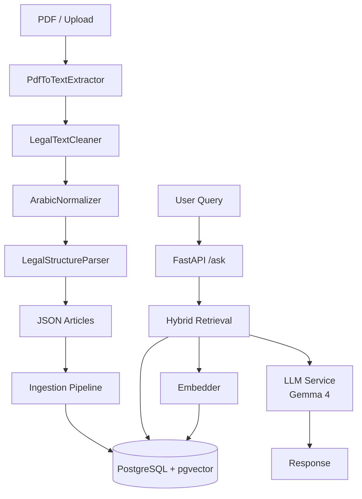

# Moroccan Legal RAG

<p align="center">
  
</p>

<p align="center">
  <a href="https://www.kaggle.com/datasets/ezzoubairzarqi/lois-justice-marocain"></a>
  <a href="https://doi.org/10.34740/kaggle/dsv/19560674"></a>
  <a href="LICENSE"></a>
</p>

> An Arabic NLP and Retrieval-Augmented Generation (RAG) platform specialized in Moroccan law.

---

## Showcase

[Showcase-video.webm](https://github.com/user-attachments/assets/2d89fe7b-4a95-487b-bd4a-131bd8ba7b0d)

---

## Dataset: Lois Justice Marocain

The system is built upon **Lois Justice Marocain**, a comprehensive Arabic legal corpus curated, normalized, and structured specifically for natural language processing, legal information retrieval, and Retrieval-Augmented Generation (RAG).

- **Kaggle Dataset**: [kaggle.com/datasets/ezzoubairzarqi/lois-justice-marocain](https://www.kaggle.com/datasets/ezzoubairzarqi/lois-justice-marocain)
- **DOI**: [10.34740/kaggle/dsv/19560674](https://doi.org/10.34740/kaggle/dsv/19560674)
- **Direct DOI URL**: https://doi.org/10.34740/kaggle/dsv/19560674
- **Primary Language**: Modern Standard Arabic (MSA) / Legal Arabic (with dialectal Darija user query support)
- **Corpus Scale**: 2,360+ structured legal articles across 6 major Moroccan legal codes

### Dataset Description

Legal texts in Morocco are distributed across official gazettes (*Bulletin Officiel* / الجريدة الرسمية), judicial decrees, and statutory codes. The **Lois Justice Marocain** dataset gathers these primary legal sources and transforms unstructured digital and scanned PDF documents into machine-readable, semantically tagged, and searchable legal articles.

Each document undergoes a rigorous Arabic NLP pipeline:
1. **Extraction**: Hybrid extraction utilizing PyMuPDF, pdfplumber, and OCR/VLM models for scanned historical bulletins.
2. **Text Normalization**: Orthographic normalization (alif/ya/ta-marbuta harmonization, diacritic removal, ligature repair, Tatweel stripping) via `camel-tools` and custom regex cleaners.
3. **Structural Parsing**: Hierarchical document chunking that preserves the legal context (Part $\rightarrow$ Book $\rightarrow$ Title $\rightarrow$ Chapter $\rightarrow$ Section $\rightarrow$ Article $\rightarrow$ Sub-clauses and Footnotes).

### Legal Domains & Article Distribution

| Legal Domain | Source Code / Legislation | Articles | Description |
| :--- | :--- | :---: | :--- |
| **Criminal Law** (الجنائي) | Moroccan Penal Code & Sanctions (*Code Pénal*) | 824 | Offenses, felonies, misdemeanors, penal classifications, and statutory penalties |
| **Civil Law** (المدني) | Code of Obligations & Contracts (*DOC*) & Constitution | 706 | Contractual obligations, torts, civil liabilities, and constitutional rights |
| **Commercial Law** (التجاري) | Commercial Code & Law No. 5.96 (Partnerships) | 359 | Trade records (*Registre du Commerce*), business associations, and corporate governance |
| **Traffic Law** (السير) | Moroccan Highway Code (*Code de la Route*) | 228 | Road rules, traffic violations, license point system, and vehicle regulations |
| **Tax Law** (الضرائب) | General Tax Code 2024 (*Code Général des Impôts*) | 211 | Corporate tax, income tax, VAT, stamp duties, and tax administration |
| **Judicial Organization** (التنظيم القضائي) | Law No. 38.15 & Judicial Map Decree | 32 | Court hierarchies, judicial jurisdictions, and territorial competence |

### Data Schema

Articles are provided in both raw text (`.txt`) and parsed JSON (`.articles.json`). Each article record contains:

```json
{
  "article_number": "512",
  "text": "يمكن لقاضي الأحداث لدى المحكمة الابتدائية بناء على ملتمس النيابة العامة أن يتخذ لفائدة الحدث الموجود في وضعية صعبة أي تدبير يراه كفيلا بحمايته...",
  "footnotes": [],
  "context": "الجزء الأول: في الأفعال التي لا توجب عقوبة جنائية > الباب الأول: حماية الأحداث",
  "law_name": "code-penal-maroc-ar",
  "domain": "criminal"
}
```

- `article_number`: The official legislative article identifier.
- `text`: Fully cleaned, normalized, and searchable legal prose.
- `footnotes`: Extracted amendments, cross-references, and decree modifications.
- `context`: Breadcrumb path of the legal hierarchy preserving enclosing legislative scope.
- `law_name`: Standardized source code identifier.
- `domain`: High-level domain classification for filtered vector retrieval.

### Dataset Package Structure

The dataset archive (`lois-justice-marocain.zip`) includes:
- `raw/`: Official source PDFs in Arabic (along with select bilingual French reference codes).
- `processed/`: Cleaned text files and structured `.articles.json` categorized by legal domain (`civil/`, `commercial/`, `criminal/`, `judicial/`, `tax/`, `traffic/`).
- `ocr_vlm_data/`: Vision-Language Model and OCR annotations for complex tables, scanned decrees, and sanction matrices.
- `metadata/`: Document processing metrics, article counts, and classification logs (`processing_summary.csv`).


---

## Architecture



---

## Tech Stack

| Layer              | Technology                                      |
| ------------------ | ----------------------------------------------- |
| Backend API        | FastAPI (Python)                                |
| Database           | PostgreSQL 16 + pgvector 0.7.4                  |
| Embeddings         | Sentence-Transformers (BAAI/bge-m3)              |
| Retrieval          | Hybrid — Dense (cosine) + BM25 + RRF            |
| LLM                | Gemma 4 (served on Colab GPU via Cloudflare)     |
| Frontend           | SvelteKit 5 + Tailwind CSS 4 + TypeScript       |
| Containerization   | Docker / Docker Compose                         |
| Arabic NLP         | camel-tools + custom normalizer & cleaner        |
| PDF / OCR          | PyMuPDF, pdfplumber, Tesseract, EasyOCR          |

---

## Project Structure

```
src/
├── api/                # FastAPI (routers, dependencies)
├── extraction/         # PDF extraction (strategy pattern)
├── preprocessing/      # Cleaner, normalizer, structure parser
├── ingestion/          # JSON → Embed → DB pipeline
├── generation/         # LLM client (remote Gemma 4)
├── retrieval/          # Hybrid search engine
│   └── strategies/     # Dense, BM25, RRF
├── ocr/                # EasyOCR client
└── utils/              # Config, DB helpers

data/                   # Dataset & corpus files
├── raw/                # Source official PDFs
├── processed/          # Domain-sorted .articles.json & .txt files
├── metadata/           # Processing summaries and metrics
└── ocr_vlm_data/       # OCR & VLM extracted annotations

web/                    # SvelteKit frontend
docker/                 # Dockerfiles (API, Postgres, Web)
scripts/                # Batch processing & utilities
notebooks/              # Colab research notebooks
config/                 # YAML configuration files
```

---

## Quick Start

```bash
# 1. Environment
python -m venv venv && source venv/bin/activate
pip install -r requirements.txt

# 2. Start PostgreSQL
docker compose up -d postgres

# 3. Configure
cp .env.example .env   # Set DB & LLM credentials

# 4. Ingest legal documents
python -m src.ingestion.pipeline

# 5. Run API
uvicorn src.main:app --reload

# 6. Frontend
cd web && npm install && npm run dev
```

---

## Features

- **Arabic Q&A** — Ask legal questions in Arabic, get grounded answers
- **Hybrid Search** — Semantic + keyword retrieval with RRF re-ranking
- **PDF Ingestion** — Upload, OCR, extract, normalize, and index legal texts
- **Remote LLM** — Gemma 4 served on Colab GPU, accessed via Cloudflare Tunnel
- **Conversations** — Multi-turn chat with context memory
- **TUI** — Terminal UI powered by Textual

---

## Docker Services

```bash
docker compose up -d              # Start PostgreSQL + pgAdmin
docker compose up -d --build api  # Start FastAPI
docker compose up -d --build web  # Start SvelteKit
```

---

## Citation

If you use the **Lois Justice Marocain** dataset or this project in your research, please cite:

```bibtex
@misc{zarqi2024loisjustice,
  author       = {Ezzoubair Zarqi},
  title        = {Lois Justice Marocain Dataset},
  year         = {2024},
  publisher    = {Kaggle},
  doi          = {10.34740/kaggle/dsv/19560674},
  url          = {https://www.kaggle.com/datasets/ezzoubairzarqi/lois-justice-marocain}
}
```

---

## License

This project is licensed under the [MIT License](LICENSE).
