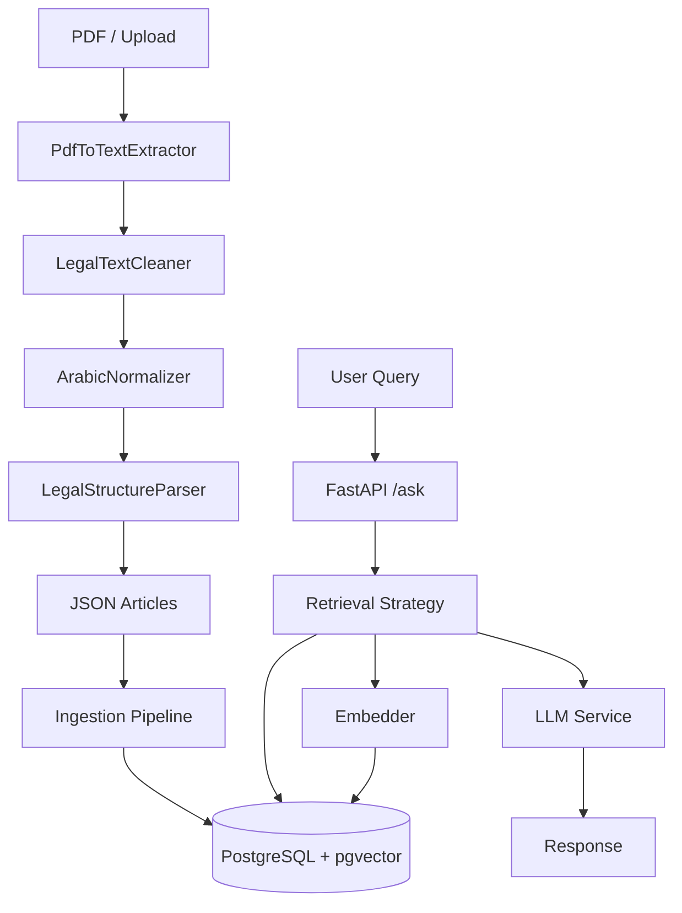

# Moroccan Legal RAG — Refactoring Plan

> **Date:** 2026-06-06  
> **Project:** Analyse-des-lois-justice-Maroc (Moroccan Legal RAG)  
> **Goal:** Improve codebase maintainability, readability, consistency, and test coverage.

---

## Table of Contents

1. [Project Context Overview](#1-project-context-overview)
2. [Current Architecture](#2-current-architecture)
3. [Detected Issues](#3-detected-issues)
4. [Refactoring Roadmap](#4-refactoring-roadmap)
   - [Phase 1: Structural Consistency](#phase-1-structural-consistency)
   - [Phase 2: Code Quality & Duplication](#phase-2-code-quality--duplication)
   - [Phase 3: Configuration & Environment](#phase-3-configuration--environment)
   - [Phase 4: API & Error Handling](#phase-4-api--error-handling)
   - [Phase 5: Testing & CI](#phase-5-testing--ci)
   - [Phase 6: Documentation & Onboarding](#phase-6-documentation--onboarding)
   - [Phase 7: Frontend Alignment](#phase-7-frontend-alignment)
5. [Priority Matrix](#5-priority-matrix)
6. [Long-Term Recommendations](#6-long-term-recommendations)

---

## 1. Project Context Overview

**What it does:** An Arabic NLP and Retrieval-Augmented Generation (RAG) platform specialized in Moroccan law. It processes legal PDFs, extracts/normalizes Arabic text, builds semantic embeddings, stores them in PostgreSQL+pgvector, and provides hybrid search (dense + BM25 + RRF) + LLM-based Q&A.

### Key Tech Stack

| Layer              | Technology                              |
| ------------------ | --------------------------------------- |
| Backend API        | FastAPI                                 |
| Database           | PostgreSQL 16 + pgvector 0.7.4          |
| Embeddings         | Sentence-Transformers (BAAI/bge-m3)     |
| Retrieval          | pgvector (cosine) + rank-bm25 + RRF     |
| LLM                | Remote (Colab GPU via Cloudflare Tunnel) |
| Frontend           | SvelteKit 5 + Tailwind CSS 4            |
| Containerization   | Docker / Docker Compose                 |
| Arabic NLP         | camel-tools, custom normalizer/cleaner  |
| PDF Extraction     | PyMuPDF, pdfplumber, OCR (Tesseract)    |

### Directory Layout (src only)

```
src/
├── api/                  # FastAPI application
│   ├── main.py
│   ├── dependencies.py
│   ├── routers/          # health, search, laws, ask
│   ├── schemas/          # empty __init__.py
│   └── middleware/        # empty __init__.py
├── data_preprocessing/   # Extract→Clean→Normalize (legacy pipeline)
│   ├── cleaner.py
│   ├── normalizer.py     # EMPTY
│   ├── extractor.py      # Extractor with structure parser
│   ├── extractor_txt.py  # Standalone PDF → TXT script
│   ├── ocr_engine.py     # EMPTY
│   ├── pdf_classifier.py
│   └── structure_parser.py  # EMPTY
├── extraction/           # New extraction module (strategy pattern)
│   ├── base.py
│   ├── factory.py
│   └── pdf_to_text_extractor.py
├── generation/           # LLM client layer
│   ├── base.py
│   ├── factory.py
│   └── remote_llm.py
├── ingestion/            # Pipeline: JSON → Embed → DB
│   ├── pipeline.py
│   ├── database.py
│   ├── embedder.py
│   └── cli.py
├── ocr/                  # OCR client
│   └── easyocr_client.py
├── preprocessing/        # NEW cleaner/normalizer/structure_parser (parallel to data_preprocessing/)
│   ├── cleaner.py
│   ├── normalizer.py
│   └── structure_parser.py
├── retrieval/            # Retrieval layer
│   ├── embedder.py
│   ├── search.py
│   └── strategies/       # base, dense, bm25, rrf
└── utils/
    └── config.py
```

---

## 2. Current Architecture



---

## 3. Detected Issues

### 🟥 Critical (must fix)

| ID   | Issue                                         | Location                                        |
| ---- | --------------------------------------------- | ----------------------------------------------- |
| C-01 | **Duplicate module trees** — `data_preprocessing/` and `preprocessing/` contain overlapping functionality (cleaner, normalizer, structure_parser). | `src/data_preprocessing/` vs `src/preprocessing/` |
| C-02 | **Empty files that pretend to have structure** — several `__init__.py` and module files are completely empty yet imports may reference them. | `normalizer.py`, `ocr_engine.py`, `structure_parser.py`, `schemas/__init__.py`, `middleware/__init__.py` |
| C-03 | **No unified pipeline entry point** — preprocessing is split across `scripts/run_preprocessing_pipeline.py`, `scripts/run_structure_parser.py`, and ad-hoc scripts with no shared orchestration. | `scripts/` |
| C-04 | **DB connection code duplicated in 5+ places** — `get_connection()` with identical logic exists in `dependencies.py`, `database.py`, `dense.py`, `bm25.py`, `rrf.py`, `seed_test_data.py`, etc. | Multiple files |

### 🟡 High Priority

| ID   | Issue                                         | Location                                        |
| ---- | --------------------------------------------- | ----------------------------------------------- |
| H-01 | **`retrieval_config.yml` and `ocr_config.yml` are empty** — placeholders with no content. | `config/` |
| H-02 | **`requirements.txt` is pinned to exact versions** — uses `==` instead of `>=` making upgrades painful. | `requirements.txt` |
| H-03 | **`setup.py` has outdated/incomplete dependencies** — missing torch, transformers, sentence-transformers, etc. | `setup.py` |
| H-04 | **No centralized exceptions/error handling** — errors are handled inconsistently (some raise, some return error dicts, some log only). | Throughout |
| H-05 | **`extractor.py` in `data_preprocessing/` contains both extraction AND structure parsing** — violates SRP. | `data_preprocessing/extractor.py` |
| H-06 | **Tests only cover 5 out of 15+ modules** — no tests for cleaner, normalizer, structure_parser, generation, ingestion, API routes. | `tests/` |
| H-07 | **`LegalStructureParser` defined in two places** — one in `data_preprocessing/extractor.py` and another in `preprocessing/structure_parser.py` with different interfaces. | Duplicated code |
| H-08 | **`RRFRetrieval` loads entire corpus into memory** — `_load_bm25()` pulls all documents; no streaming for large corpora. | `retrieval/strategies/rrf.py` |

### 🟢 Medium Priority

| ID   | Issue                                         | Location                                        |
| ---- | --------------------------------------------- | ----------------------------------------------- |
| M-01 | **No type hints in several files** — `data_preprocessing/extractor.py` lacks modern annotations. | `data_preprocessing/extractor.py` |
| M-02 | **No logging configuration in most modules** — each file creates its own logger with inconsistent patterns. | Throughout |
| M-03 | **`generate_pdf_fixtures.py` doesn't create `sample_empty.pdf`** — the test references it but the script doesn't create it. | `scripts/generate_pdf_fixtures.py` |
| M-04 | **`config/cleaning.yaml` and `config/normalization.yaml` exist but are not consumed** — the cleaner/normalizer have hardcoded defaults. | `src/preprocessing/` |
| M-05 | **`api/middleware/` and `api/schemas/` directories are empty** — schemas are defined inline in routers. | `src/api/` |
| M-06 | **No `.env.example`** — environment variables are documented nowhere. | Project root |
| M-07 | **`extract_legal.py` at root** — orphaned script, not part of any module. | Project root |
| M-08 | **`web/` frontend types duplicate backend schemas** — `types.ts` mirrors Pydantic models manually. | `web/src/lib/types.ts` |

### 🔵 Low Priority

| ID   | Issue                                         | Location                                        |
| ---- | --------------------------------------------- | ----------------------------------------------- |
| L-01 | **No `pyproject.toml`** — `setup.py` is the legacy format. | Project root |
| L-02 | **`makefile` only has `test` target** — missing `install`, `lint`, `format`, `run` targets. | Project root |
| L-03 | **No pre-commit hooks or linter config** — no `.flake8`, `.pylintrc`, `pyproject.toml` section for linters. | Project root |
| L-04 | **`docker/Dockerfile.api` and `docker/Dockerfile.web` exist but docker-compose only starts postgres+pgadmin** — API and web containers are not wired. | `docker/` |
| L-05 | **No `shell_scripts/` should be in the repo** — `inspect_db.sh` could be a Makefile target. | `shell_scripts/` |
| L-06 | **`notebooks/` could be moved to a `research/` folder** — they're exploration artifacts, not core code. | `notebooks/` |

---

## 4. Refactoring Roadmap

### Phase 1: Structural Consistency

**Goal:** Eliminate duplicate module trees and empty placeholder files.

| #   | Task                                                         | Effort | Impact |
| --- | ------------------------------------------------------------ | ------ | ------ |
| 1.1 | **Consolidate `data_preprocessing/` → `preprocessing/`**     | 3d     | High   |
|     | Move `pdf_classifier.py` → `preprocessing/`                 |        |        |
|     | Move `extractor_txt.py` → `preprocessing/` (or scripts/)    |        |        |
|     | Merge `LegalTextCleaner` from both locations                 |        |        |
|     | Merge `ArabicNormalizer` implementations                     |        |        |
|     | Merge `LegalStructureParser` from both locations             |        |        |
|     | Delete `data_preprocessing/` after merge                     |        |        |
| 1.2 | **Remove empty placeholder files**                           | 0.5d   | Medium |
|     | Delete empty `normalizer.py`, `ocr_engine.py`, `structure_parser.py` in `data_preprocessing/` |        |        |
|     | Delete empty `middleware/__init__.py`, `schemas/__init__.py` (or implement them) |        |        |
| 1.3 | **Create proper `__init__.py` files**                        | 0.5d   | Medium |
|     | Export public API from each package                          |        |        |
|     | Enable `from src.preprocessing import LegalTextCleaner` style imports |        |        |

### Phase 2: Code Quality & Duplication

**Goal:** Eliminate duplicated code, standardize patterns.

| #   | Task                                                         | Effort | Impact |
| --- | ------------------------------------------------------------ | ------ | ------ |
| 2.1 | **Centralize DB connection**                                 | 1d     | High   |
|     | Create `src/utils/database.py` with `get_connection()` singleton or connection pool |        |        |
|     | Remove all duplicate `get_connection()` from `dependencies.py`, `dense.py`, `bm25.py`, `rrf.py`, `database.py` |        |        |
|     | Use `from src.utils.database import get_connection` everywhere |        |        |
| 2.2 | **Centralize config loading**                                | 1d     | High   |
|     | Make `src/utils/config.py` load ALL YAML configs (cleaning, normalization, ocr, retrieval) |        |        |
|     | Pass config to cleaner/normalizer instead of hardcoded defaults |        |        |
| 2.3 | **Create unified logging module**                            | 0.5d   | Medium |
|     | `src/utils/logging.py` with consistent format, level from env |        |        |
|     | Replace ad-hoc `logger = logging.getLogger(__name__)` with centralized setup |        |        |
| 2.4 | **Standardize error handling**                               | 1d     | Medium |
|     | Create custom exceptions: `LegalExtractionError`, `EmbeddingError`, `RetrievalError`, `LLMConnectionError` |        |        |
|     | Make `classify_pdf()` raise instead of returning error dicts |        |        |
|     | Add proper FastAPI exception handlers in `main.py`           |        |        |
| 2.5 | **Add type hints throughout**                                | 2d     | Medium |
|     | Complete type annotations in `data_preprocessing/extractor.py` |        |        |
|     | Ensure all public functions have typed signatures            |        |        |

### Phase 3: Configuration & Environment

**Goal:** Make configs actually used, clean up environment setup.

| #   | Task                                                         | Effort | Impact |
| --- | ------------------------------------------------------------ | ------ | ------ |
| 3.1 | **Implement config file consumption**                        | 1d     | High   |
|     | Make `LegalTextCleaner` read from `cleaning.yaml`            |        |        |
|     | Make `ArabicNormalizer` read from `normalization.yaml`       |        |        |
|     | Populate `retrieval_config.yml` and `ocr_config.yml` with real defaults |        |        |
| 3.2 | **Create `.env.example`**                                    | 0.5d   | High   |
|     | Document all env vars: `POSTGRES_*`, `EMBEDDING_SERVICE_URL`, `LLM_SERVICE_URL`, `EASYOCR_SERVICE_URL` |        |        |
| 3.3 | **Move to `pyproject.toml`**                                 | 1d     | Low    |
|     | Replace `setup.py` with modern `pyproject.toml`              |        |        |
|     | Use `>=` version specifiers instead of `==`                  |        |        |
| 3.4 | **Update `requirements.txt`**                                | 0.5d   | Medium |
|     | Sync with actual dependencies used in code                   |        |        |
|     | Group into sections: core, nlp, ocr, dev                     |        |        |

### Phase 4: API & Error Handling

**Goal:** Robust API with proper middleware, schemas, and error responses.

| #   | Task                                                         | Effort | Impact |
| --- | ------------------------------------------------------------ | ------ | ------ |
| 4.1 | **Move schemas to `api/schemas/`**                           | 0.5d   | Medium |
|     | Extract Pydantic models from routers into `api/schemas/search.py`, `api/schemas/ask.py`, etc. |        |        |
|     | Keep routers lean — only route logic                         |        |        |
| 4.2 | **Implement proper middleware**                              | 1d     | Medium |
|     | Request logging middleware                                    |        |        |
|     | Request timing middleware                                     |        |        |
|     | Rate limiting (optional)                                      |        |        |
| 4.3 | **Add exception handlers**                                   | 0.5d   | High   |
|     | Global `@app.exception_handler` for `ValueError`, `ConnectionError`, etc. |        |        |
|     | Consistent JSON error response format                        |        |        |
| 4.4 | **Improve `/ask` response parsing**                          | 0.5d   | Medium |
|     | `parse_llm_response()` is fragile — consider structured JSON output from LLM |        |        |
|     | Add fallback when LLM is unavailable (already partially done) |        |        |

### Phase 5: Testing & CI

**Goal:** Achieve >60% test coverage, add CI pipeline.

| #   | Task                                                         | Effort | Impact |
| --- | ------------------------------------------------------------ | ------ | ------ |
| 5.1 | **Add tests for cleaner**                                    | 1d     | High   |
|     | Test `LegalTextCleaner` (both `preprocessing/` versions)     |        |        |
|     | Test watermark removal, page number removal, dedup           |        |        |
| 5.2 | **Add tests for normalizer**                                 | 0.5d   | High   |
|     | Test `ArabicNormalizer` with alef unification, digit conversion, diacritic removal |        |        |
| 5.3 | **Add tests for structure parser**                           | 1d     | High   |
|     | Test `LegalStructureParser` with real Moroccan legal text    |        |        |
|     | Test heading detection, article boundary detection           |        |        |
| 5.4 | **Add tests for API routes**                                 | 1d     | Medium |
|     | Test `/health`, `/search`, `/laws`, `/ask` with TestClient   |        |        |
|     | Mock retrieval strategy and LLM                              |        |        |
| 5.5 | **Add tests for ingestion pipeline**                         | 1d     | Medium |
|     | Test `ingest_articles()` with mocked DB and embedder         |        |        |
|     | Test `build_article_text()` formatting                       |        |        |
| 5.6 | **Add CI workflow**                                          | 1d     | High   |
|     | GitHub Actions: `pytest`, `flake8`, `mypy` on push/PR        |        |        |
|     | Add `ruff` or `black` formatting check                       |        |        |
| 5.7 | **Fix `generate_pdf_fixtures.py`**                           | 0.5d   | Low    |
|     | Add `create_empty_pdf()` to script                           |        |        |
|     | Regenerate all fixtures after fix                            |        |        |

### Phase 6: Documentation & Onboarding

**Goal:** Clear, complete documentation for new contributors.

| #   | Task                                                         | Effort | Impact |
| --- | ------------------------------------------------------------ | ------ | ------ |
| 6.1 | **Create `CONTRIBUTING.md`**                                 | 1d     | High   |
|     | Setup guide, coding standards, PR checklist                  |        |        |
| 6.2 | **Add docstrings to all public APIs**                        | 2d     | Medium |
|     | Focus on `src/retrieval/`, `src/generation/`, `src/api/`     |        |        |
| 6.3 | **Add `ARCHITECTURE.md`**                                    | 1d     | Medium |
|     | Document the component diagram, data flow, deployment model  |        |        |
|     | Reference existing `docs/Architecture/` files                |        |        |

### Phase 7: Frontend Alignment

**Goal:** Type-safe frontend that stays in sync with the backend.

| #   | Task                                                         | Effort | Impact |
| --- | ------------------------------------------------------------ | ------ | ------ |
| 7.1 | **Generate TypeScript types from Pydantic models**           | 1d     | Medium |
|     | Use `datamodel-code-generator` or manual sync script         |        |        |
|     | Or add OpenAPI generation + `openapi-typescript` in CI       |        |        |
| 7.2 | **Wire Docker Compose for full stack**                       | 1d     | Medium |
|     | Add API service to `docker-compose.yaml`                     |        |        |
|     | Add web frontend service                                     |        |        |

---

## 5. Priority Matrix

```
                    High Impact         Medium Impact        Low Impact
                ┌───────────────────┬────────────────────┬──────────────────┐
   High Effort  │  Phase 1 (3 days) │ Phase 2 (2 days)   │ Phase 7 (2 days) │
                │  C-01, C-02, C-03│ H-05, H-07, M-01   │ M-08, L-04       │
                ├───────────────────┼────────────────────┼──────────────────┤
   Med Effort   │  Phase 5 (2 days) │ Phase 3 (2 days)   │ Phase 6 (2 days) │
                │  C-04, H-06       │ H-01, H-02, H-03   │ M-06             │
                ├───────────────────┼────────────────────┼──────────────────┤
   Low Effort   │  Phase 4 (1 day)  │ H-04, M-02         │ L-01, L-02, L-03 │
                │  M-05             │                    │ L-05, L-06, M-03 │
                └───────────────────┴────────────────────┴──────────────────┘
```

**Recommended order:** Phase 1 → Phase 3 → Phase 4 → Phase 5 → Phase 2 → Phase 6 → Phase 7

---

## 6. Long-Term Recommendations

1. **Add BM25 with `rank_bm25` loaded from DB lazily** — `RRFRetrieval._load_bm25()` loads ALL documents; for large corpora (>100K docs), use DB-side full-text search (which already exists via `search_vector` column) or streaming BM25.

2. **Implement local LLM fallback** — The `generation/` module currently only supports remote LLM. Adding `LocalLLM` (via `llama.cpp`, `vLLM`, or `Ollama`) would make the system usable offline.

3. **Add APM / monitoring** — FastAPI + OpenTelemetry or Prometheus metrics for production observability.

4. **Consider `langchain` or `llama_index` integration** — Only if custom retrieval strategies need to be supplemented with off-the-shelf RAG pipelines, otherwise the current custom implementation is fine.

5. **Add data versioning** — Track which version of embeddings/models was used for ingestion to enable reproducibility.

6. **Extract OCR into a proper module** — `src/ocr/` has only `easyocr_client.py`. Integrate with the extraction pipeline properly (it's currently disconnected).

7. **Implement `reranker.py` and `query_expander.py`** — These files are referenced in `REPOSITORY.md` but don't exist. They would improve retrieval quality.

---

## Appendix: File Inventory

### Files that should be **removed** after refactoring

| File                                                         | Reason                          |
| ------------------------------------------------------------ | ------------------------------- |
| `src/data_preprocessing/` (entire directory)                  | Replaced by `src/preprocessing/`|
| `src/data_preprocessing/normalizer.py`                       | Empty                           |
| `src/data_preprocessing/ocr_engine.py`                       | Empty                           |
| `src/data_preprocessing/structure_parser.py`                 | Empty                           |
| `shell_scripts/inspect_db.sh`                                | Belongs in Makefile             |
| `extract_legal.py`                                           | Orphaned root-level script      |
| `config/retrieval_config.yml` (if stays empty)               | Remove or populate              |
| `config/ocr_config.yml` (if stays empty)                     | Remove or populate              |

### Files that need **significant rework**

| File                                                         | Action                          |
| ------------------------------------------------------------ | ------------------------------- |
| `src/data_preprocessing/extractor.py`                        | Merge structure_parser logic out|
| `src/api/dependencies.py`                                    | Use centralized DB module       |
| `src/retrieval/strategies/dense.py`                          | Use centralized DB module       |
| `src/retrieval/strategies/bm25.py`                           | Use centralized DB module       |
| `src/retrieval/strategies/rrf.py`                            | Use centralized DB module + lazy BM25 |
| `tests/generate_pdf_fixtures.py`                             | Add empty PDF generation        |
| `setup.py` / `requirements.txt`                              | Migrate to pyproject.toml       |

---

*This plan was generated by analyzing the full codebase as of 2026-06-06. Each phase is designed to be done incrementally, and the priority matrix helps decide what to tackle first.*
