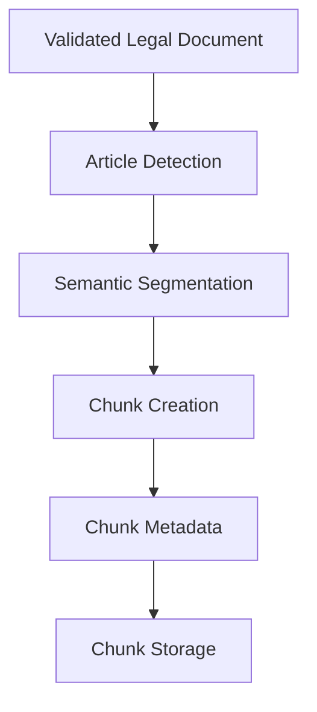

# Phase 2 — Processing and Validation of Raw Legal Data

# 1. Introduction

After completing the data gathering stage, the next phase focuses on transforming raw Arabic legal text into a clean, validated, and machine-processable legal corpus.

The purpose of this phase is to improve the quality, consistency, and reliability of the extracted legal data before it enters the NLP and Retrieval-Augmented Generation (RAG) pipeline.

This stage is critical because noisy or inconsistent legal text directly reduces retrieval accuracy and negatively affects the quality of generated legal answers.

---

# 2. Objectives of the Processing Phase

The main objectives are:

- Clean OCR-generated Arabic text
- Validate extracted legal documents
- Normalize Arabic legal language
- Remove corrupted or duplicated content
- Detect formatting inconsistencies
- Prepare documents for semantic chunking
- Produce standardized structured datasets

---

# 3. Raw Data Challenges

The collected legal documents may contain multiple issues caused by OCR systems, document formatting, or inconsistent legal sources.

## Common Problems

| Problem | Description |
|---|---|
| OCR Noise | Incorrect Arabic characters |
| Duplicate Text | Repeated paragraphs or articles |
| Encoding Errors | Unicode inconsistencies |
| Mixed Languages | Arabic and French mixed together |
| Broken Sentences | Incomplete extraction |
| Missing Metadata | Undefined legal categories |
| Irregular Formatting | Random spacing and symbols |

---

# 4. Processing Pipeline Architecture

```mermaid
flowchart TD

A[Raw Legal Dataset]
--> B[Encoding Validation]

B --> C[OCR Noise Removal]
C --> D[Arabic Normalization]

D --> E[Regex Cleaning]
E --> F[Duplicate Detection]

F --> G[Language Validation]
G --> H[Metadata Validation]

H --> I[Chunk Preparation]
I --> J[Validated Legal Corpus]
````

---

# 5. Encoding and Unicode Validation

Arabic legal documents often contain encoding inconsistencies caused by OCR systems or incompatible document formats.

## Validation Tasks

* Ensure UTF-8 compatibility
* Remove corrupted Unicode characters
* Detect unreadable symbols
* Repair malformed Arabic text

## Example

| Invalid Text   | Corrected Text |
| -------------- | -------------- |
| محكمة     | محكمة          |
| القانون | القانون        |

---

# 6. OCR Noise Removal

OCR-generated Arabic text may contain false characters, spacing issues, or fragmented words.

## Cleaning Goals

* Remove meaningless symbols
* Correct spacing issues
* Eliminate repeated punctuation
* Preserve legal structure

## Example

| OCR Output      | Clean Output |
| --------------- | ------------ |
| الــمـحـكــمــة | المحكمة      |
| غرامة....،،،،   | غرامة        |
| ال قان ون       | القانون      |

---

# 7. Arabic Text Normalization

Arabic normalization improves semantic consistency and retrieval performance.

## Normalization Rules

| Original   | Normalized   |
| ---------- | ------------ |
| أ / إ / آ  | ا            |
| ى          | ي            |
| ـــــ      | removed      |
| ة          | standardized |
| diacritics | removed      |

---

# 8. Regex-Based Cleaning

Regular expressions are used to identify and clean repetitive legal formatting patterns.

## Regex Tasks

* Remove page numbers
* Remove headers and footers
* Detect article numbering
* Remove duplicated spaces
* Extract legal references

## Example

```python id="6zr2m1"
pattern = r'المادة\s+\d+'
```

---

# 9. Duplicate Detection

Legal datasets may contain duplicated articles or repeated content across different documents.

## Detection Methods

* Exact text matching
* Hash comparison
* Cosine similarity
* Semantic duplicate detection

## Objective

Reduce redundancy inside the legal knowledge base.

---

# 10. Language Validation

Some Moroccan legal documents contain both Arabic and French text.

The system must detect language distribution inside documents.

## Validation Goals

* Detect Arabic-dominant content
* Separate French segments
* Preserve bilingual metadata
* Support multilingual retrieval later

---

# 11. Metadata Validation

Each legal document must contain complete and consistent metadata.

## Required Metadata

| Field          | Validation Rule          |
| -------------- | ------------------------ |
| law_type       | Must exist               |
| title          | Cannot be empty          |
| source         | Must reference origin    |
| language       | Arabic or French         |
| article_number | Structured format        |
| tags           | Optional but recommended |

---

# 12. Legal Document Classification

During processing, documents may be automatically classified into legal domains.

## Possible Categories

* قانون السير
* القانون الجنائي
* قانون الأسرة
* القانون المدني
* الإجراءات القضائية

## Classification Pipeline


---

# 13. Chunk Preparation

Large legal documents cannot be embedded as a single block.

The system must divide documents into smaller semantic chunks.

## Chunking Objectives

* Preserve legal meaning
* Maintain article boundaries
* Improve retrieval precision
* Reduce embedding noise

## Recommended Chunk Structure

| Chunk Element | Description               |
| ------------- | ------------------------- |
| article_title | Legal topic               |
| article_text  | Main content              |
| explanation   | Simplified interpretation |
| metadata      | Legal information         |

---

# 14. Chunking Architecture



---

# 15. Output Dataset Structure

After validation and processing, the final dataset becomes structured and retrieval-ready.

## Example JSON Structure

```json id="7xz4pt"
{
  "id": "LAW_CHUNK_001",
  "law_type": "القانون الجنائي",
  "article_number": "507",
  "title": "السرقة",
  "chunk_text": "يعاقب على السرقة...",
  "normalized_text": "يعاقب علي السرقه...",
  "source": "القانون الجنائي المغربي",
  "language": "ar",
  "tags": ["سرقة", "عقوبة", "جريمة"]
}
```

---

# 16. Validation Metrics

The quality of processed legal data must be evaluated.

## Validation Indicators

| Metric                | Purpose                 |
| --------------------- | ----------------------- |
| OCR Accuracy          | Text extraction quality |
| Duplicate Ratio       | Redundancy detection    |
| Arabic Consistency    | Normalization quality   |
| Metadata Completeness | Dataset reliability     |
| Chunk Quality         | Retrieval effectiveness |

---

# 17. Technologies and Libraries

## Recommended Python Libraries

| Library               | Usage                |
| --------------------- | -------------------- |
| re                    | Regex processing     |
| pandas                | Dataset manipulation |
| camel-tools           | Arabic NLP           |
| pyarabic              | Arabic normalization |
| langdetect            | Language detection   |
| nltk                  | Text preprocessing   |
| sentence-transformers | Semantic validation  |

---

# 18. Expected Output of Phase 2

At the end of this phase, the system should produce:

* Clean Arabic legal corpus
* Normalized legal text
* Validated metadata
* Structured legal chunks
* Deduplicated dataset
* Retrieval-ready corpus

---

# 19. Conclusion

The processing and validation phase transforms raw legal documents into a high-quality Arabic legal corpus suitable for semantic retrieval and LLM-based reasoning.

This stage directly impacts the effectiveness of embeddings, hybrid retrieval, reranking, and final legal answer generation.

A properly validated dataset reduces hallucinations, improves legal relevance, and increases the reliability of the Moroccan Legal RAG system.
