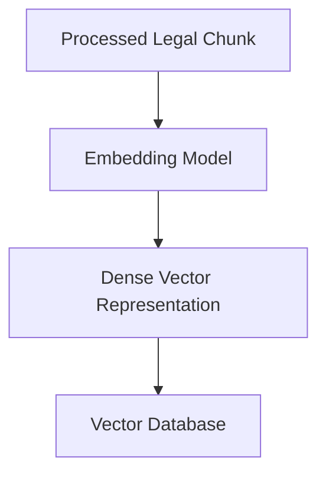
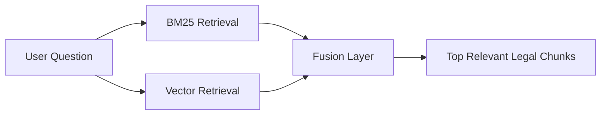
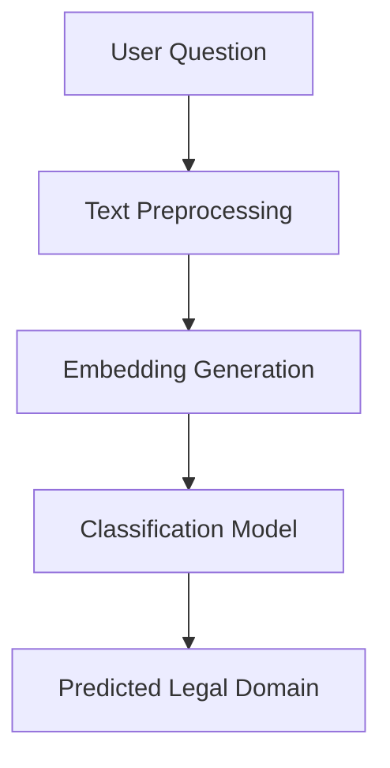
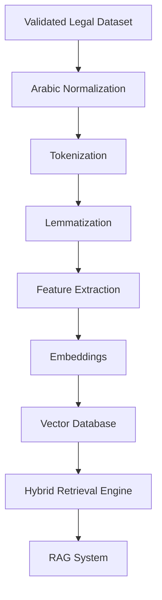

# Phase 3 — NLP Pipeline Construction

# 1. Introduction

After collecting, cleaning, and validating the Moroccan legal corpus, the next phase focuses on building the Natural Language Processing (NLP) pipeline.

The NLP pipeline is responsible for transforming processed Arabic legal text into machine-understandable representations suitable for semantic search, classification, embeddings, retrieval, and legal question answering.

This phase establishes the linguistic intelligence layer of the system and prepares the legal corpus for Retrieval-Augmented Generation (RAG).

---

# 2. Objectives of the NLP Pipeline

The main objectives are:

- Process Arabic legal language
- Standardize legal text representations
- Extract semantic meaning from legal documents
- Prepare legal chunks for embeddings
- Enable legal classification and retrieval
- Improve semantic matching between questions and legal texts

---

# 3. NLP Pipeline Architecture

```mermaid
flowchart TD

A[Validated Legal Corpus]
--> B[Text Normalization]

B --> C[Tokenization]
C --> D[Stopword Removal]

D --> E[Lemmatization]
E --> F[Feature Extraction]

F --> G[Embeddings Generation]
G --> H[Vector Storage]

H --> I[Retrieval Pipeline]
````

---

# 4. Arabic NLP Challenges

Arabic legal language introduces several linguistic complexities.

## Main Challenges

| Challenge          | Description                     |
| ------------------ | ------------------------------- |
| Rich Morphology    | Multiple forms of the same word |
| Legal Terminology  | Specialized legal vocabulary    |
| Long Sentences     | Complex legal structures        |
| OCR Residue        | Remaining extraction noise      |
| Dialect Variations | Informal user questions         |
| Ambiguous Meanings | Context-sensitive legal terms   |

---

# 5. Text Normalization Stage

The NLP pipeline begins with Arabic text normalization.

The objective is to reduce lexical variations and improve semantic consistency.

## Operations

* Remove diacritics
* Normalize Arabic characters
* Remove tatweel
* Standardize punctuation
* Normalize spaces

## Example

| Original   | Normalized |
| ---------- | ---------- |
| الإبتدائية | الابتدائيه |
| القــانون  | القانون    |
| الطــلاق   | الطلاق     |

---

# 6. Tokenization

Tokenization splits Arabic legal text into meaningful linguistic units.

## Objectives

* Separate words correctly
* Preserve legal terminology
* Prepare text for embeddings

## Example

```text id="1g0q2d"
Input:
ما هي عقوبة السرقة في القانون المغربي؟

Tokens:
["ما", "هي", "عقوبة", "السرقة", "في", "القانون", "المغربي"]
```

---

# 7. Stopword Removal

Some Arabic words provide little semantic value during retrieval.

Examples:

* في
* من
* على
* إلى

The system removes non-informative words while preserving important legal terms.

## Important Constraint

Legal stopword removal must be conservative because some functional words affect legal interpretation.

---

# 8. Lemmatization

Lemmatization reduces words to their root semantic form.

This improves retrieval consistency.

## Example

| Word     | Lemma |
| -------- | ----- |
| المحاكم  | محكمة |
| الجرائم  | جريمة |
| العقوبات | عقوبة |

---

# 9. NLP Processing Pipeline


---

# 10. Feature Extraction

The system converts legal text into semantic representations.

## Extraction Goals

* Capture legal meaning
* Preserve contextual relationships
* Enable semantic similarity search

## Feature Types

| Feature Type        | Description            |
| ------------------- | ---------------------- |
| TF-IDF              | Statistical importance |
| BM25 Features       | Keyword relevance      |
| Sentence Embeddings | Semantic meaning       |
| Metadata Features   | Legal categories       |

---

# 11. Embedding Generation

Embeddings convert Arabic legal text into dense vector representations.

These vectors allow semantic comparison between:

* legal questions
* legal articles
* legal scenarios

---

# 12. Embedding Workflow



---

# 13. Recommended Embedding Models

The project requires multilingual and Arabic-capable embedding models.

## Candidate Models

| Model                          | Purpose                      |
| ------------------------------ | ---------------------------- |
| multilingual-e5-large          | Semantic retrieval           |
| paraphrase-multilingual-MiniLM | Lightweight embeddings       |
| Arabic SBERT                   | Arabic semantic similarity   |
| Instructor-XL                  | Instruction-aware embeddings |

---

# 14. Hybrid Retrieval Preparation

The NLP pipeline prepares data for hybrid retrieval systems.

The architecture combines:

* Semantic retrieval using embeddings
* Lexical retrieval using BM25

This improves legal search precision.

## Hybrid Retrieval Concept



---

# 15. Legal Query Understanding

The NLP layer also processes user legal questions.

## Query Processing Tasks

* Detect legal intent
* Normalize user questions
* Identify legal entities
* Predict legal domain

---

# 16. Automatic Legal Classification

The system can classify legal questions into categories.

## Example

| User Question        | Category        |
| -------------------- | --------------- |
| كيف أرفع دعوى طلاق؟  | قانون الأسرة    |
| ما عقوبة السرقة؟     | القانون الجنائي |
| ما هي مخالفة السرعة؟ | قانون السير     |

---

# 17. Classification Pipeline



---

# 18. Metadata Enrichment

During NLP processing, additional metadata may be generated automatically.

## Generated Metadata

| Metadata       | Purpose                |
| -------------- | ---------------------- |
| keywords       | Retrieval optimization |
| legal_entities | Legal references       |
| semantic_tags  | Topic clustering       |
| language_score | Bilingual support      |

---

# 19. Vector Storage Integration

After embedding generation, vectors are stored inside a vector-capable database.

## Candidate Storage Systems

| Database              | Usage                    |
| --------------------- | ------------------------ |
| PostgreSQL + pgvector | Unified storage          |
| FAISS                 | Local vector search      |
| ChromaDB              | Lightweight vector DB    |
| Qdrant                | Production vector search |

---

# 20. NLP Pipeline Technologies

## Recommended Libraries

| Library               | Purpose              |
| --------------------- | -------------------- |
| camel-tools           | Arabic NLP           |
| pyarabic              | Arabic normalization |
| nltk                  | Tokenization         |
| transformers          | Embedding models     |
| sentence-transformers | Semantic vectors     |
| rank-bm25             | Keyword retrieval    |

---

# 21. Full NLP Pipeline Overview



---

# 22. Expected Output of Phase 3

At the end of this phase, the system should produce:

* NLP-ready Arabic legal corpus
* Tokenized legal text
* Normalized semantic representations
* Legal embeddings
* Vectorized legal chunks
* Query understanding pipeline
* Automatic legal classification system

---

# 23. Conclusion

The NLP pipeline transforms validated Arabic legal data into semantic representations suitable for retrieval and legal reasoning.

This phase serves as the bridge between raw legal text and intelligent legal question answering.

The quality of tokenization, normalization, embeddings, and classification directly impacts the retrieval precision and the final quality of generated legal responses in the Moroccan Legal RAG system.
