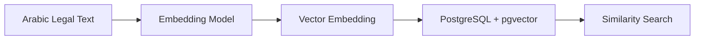
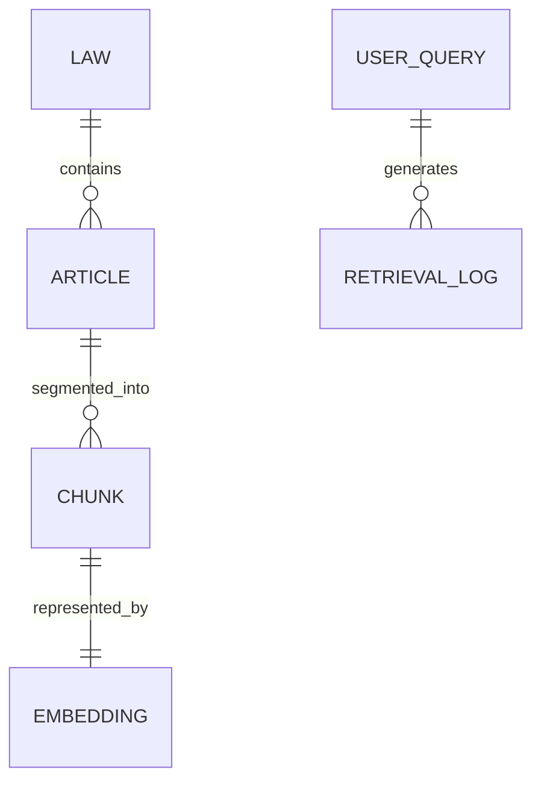
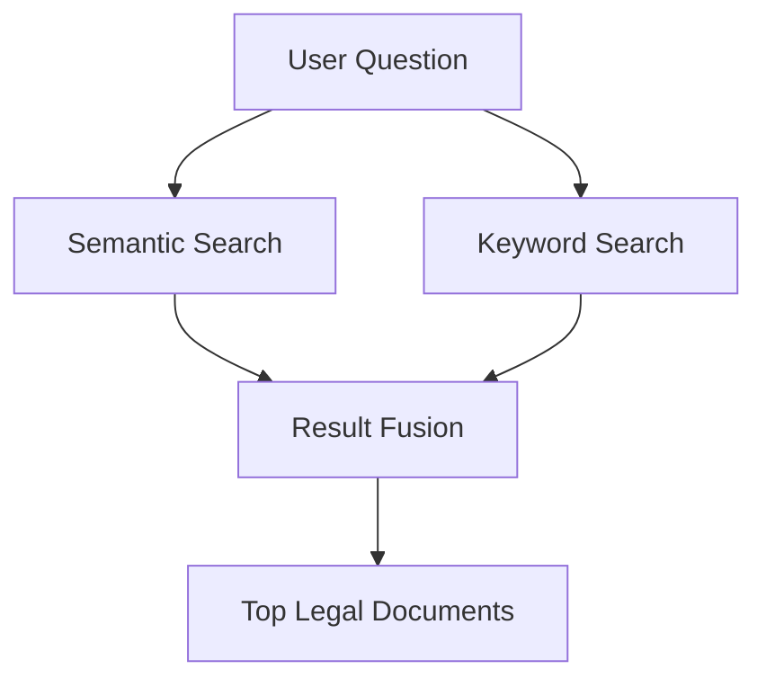
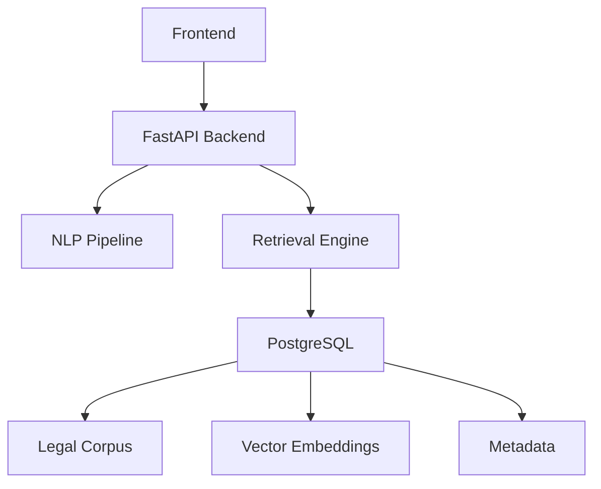
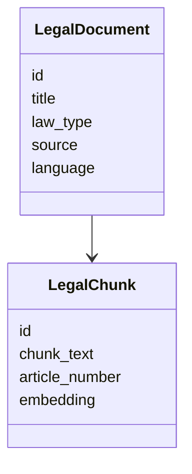

# Discussion — Why PostgreSQL Was Chosen for the Moroccan Legal RAG System

# 1. Introduction

The Moroccan Legal RAG system requires a database capable of handling:

- structured legal documents
- metadata storage
- semantic search integration
- multilingual legal content
- scalable retrieval operations
- vector embeddings

For these reasons, PostgreSQL was selected as the primary database system for the application.

PostgreSQL provides reliability, extensibility, advanced querying capabilities, and native support for modern AI workflows through vector extensions such as `pgvector`.

---

# 2. Role of the Database in the System

The database acts as the central storage layer of the entire application.

It is responsible for storing:

- legal documents
- processed legal chunks
- metadata
- vector embeddings
- user queries
- retrieval logs
- classification outputs

---

# 3. PostgreSQL Architecture in the Application

```mermaid
flowchart TD

A[Legal Documents]
--> B[Processing Pipeline]

B --> C[PostgreSQL Database]

C --> D[Legal Metadata]
C --> E[Processed Chunks]
C --> F[Embeddings]
C --> G[User Queries]

F --> H[Semantic Retrieval]
````

---

# 4. Advantages of PostgreSQL

## 4.1 Open Source and Stable

PostgreSQL is:

* open-source
* production-ready
* widely adopted
* highly reliable

This makes it suitable for academic and scalable production systems.

---

## 4.2 Structured Data Management

Legal systems require highly structured storage.

PostgreSQL supports:

* relational schemas
* constraints
* indexing
* normalization
* advanced querying

Example entities:

* laws
* articles
* legal domains
* court procedures
* metadata relations

---

## 4.3 Strong Support for JSON

Legal documents are semi-structured by nature.

PostgreSQL provides native support for:

* JSON
* JSONB

This allows storing:

* flexible metadata
* multilingual content
* extracted OCR structures
* dynamic legal annotations

Example:

```json id="7h0m4c"
{
  "law_type": "القانون الجنائي",
  "article": 507,
  "tags": ["سرقة", "جريمة"],
  "language": "ar"
}
```

---

# 5. PostgreSQL and Vector Search

One of the main reasons for choosing PostgreSQL is support for semantic vector retrieval through the `pgvector` extension.

This enables:

* embedding storage
* similarity search
* semantic retrieval
* hybrid RAG architectures

---

# 6. pgvector Integration

`pgvector` allows PostgreSQL to store vector embeddings directly inside database tables.

## Example Workflow



---

# 7. Benefits of pgvector

## Semantic Search

The system can retrieve legal documents based on meaning rather than exact keywords.

Example:

User Question:

```text id="8kt6ow"
ما عقوبة السرقة؟
```

The system retrieves semantically related articles even if exact wording differs.

---

## Unified Infrastructure

Instead of using:

* PostgreSQL for metadata
* FAISS for vectors
* separate storage systems

The application can centralize everything in one database system.

Benefits:

* simpler architecture
* easier deployment
* easier maintenance
* reduced synchronization problems

---

# 8. Metadata and Relational Design

Legal systems depend heavily on metadata relationships.

PostgreSQL allows:

* foreign keys
* indexing
* joins
* relational integrity

Example relationships:



---

# 9. Full-Text Search Support

PostgreSQL also supports traditional lexical search.

This enables:

* BM25-style retrieval
* keyword search
* legal article matching

The system can therefore implement:

* semantic retrieval
* lexical retrieval
* hybrid retrieval

inside the same infrastructure.

---

# 10. Hybrid Retrieval Architecture

The project plans to use Hybrid RAG.

Hybrid retrieval combines:

* vector similarity
* keyword relevance

Architecture:



PostgreSQL supports both retrieval methods efficiently.

---

# 11. Scalability

The legal corpus may continuously grow through:

* uploaded PDFs
* new legal documents
* additional legal domains
* multilingual expansions

PostgreSQL supports:

* large datasets
* indexing optimization
* concurrent access
* scalable deployments

---

# 12. Docker and Backend Integration

The application architecture includes:

* FastAPI backend
* Docker deployment
* NLP services

PostgreSQL integrates easily with all components.

---

# 13. Integration Architecture



---

# 14. Security and Reliability

Legal systems require reliable storage.

PostgreSQL provides:

* ACID compliance
* transaction safety
* backup support
* role management
* authentication systems

This improves:

* data consistency
* legal traceability
* system reliability

---

# 15. Why PostgreSQL Instead of Other Databases

| Database      | Limitation                    |
| ------------- | ----------------------------- |
| MongoDB       | weaker relational consistency |
| SQLite        | limited scalability           |
| FAISS         | vector-only system            |
| ChromaDB      | less mature ecosystem         |
| Elasticsearch | heavier infrastructure        |

PostgreSQL provides:

* relational storage
* vector support
* JSON support
* scalability
* mature ecosystem

inside a single platform.

---

# 16. Example Legal Table Design



---

# 17. Expected Benefits in the RAG System

Using PostgreSQL improves:

* retrieval precision
* metadata organization
* semantic search
* legal filtering
* scalability
* maintainability

It also simplifies:

* deployment
* backend integration
* monitoring
* future extensions

---

# 18. Conclusion

PostgreSQL was selected because it provides a unified and scalable solution for storing structured legal documents, metadata, and semantic vector embeddings within the same infrastructure.

Its support for relational data, JSON storage, full-text search, and vector retrieval makes it particularly suitable for modern NLP and Retrieval-Augmented Generation systems.

Combined with `pgvector`, PostgreSQL becomes a powerful foundation for building a scalable Arabic Legal AI assistant capable of semantic retrieval, legal classification, and contextual legal reasoning.

```
```
