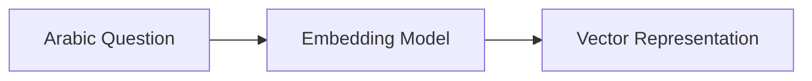
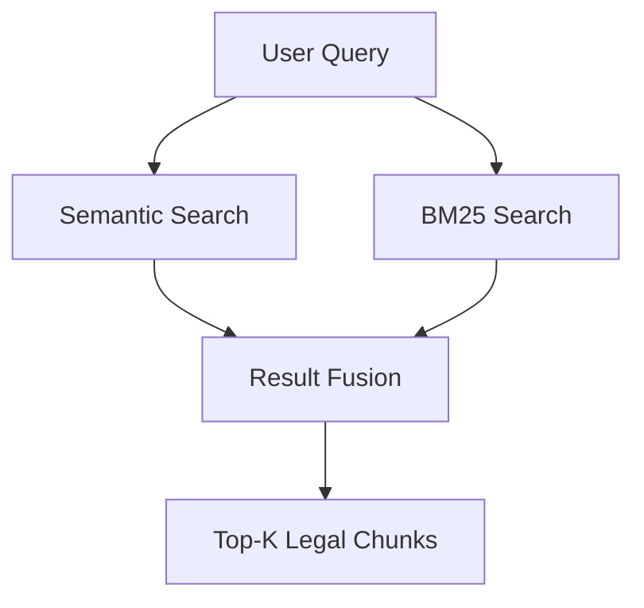
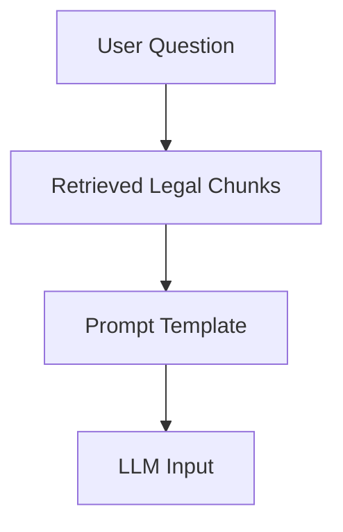
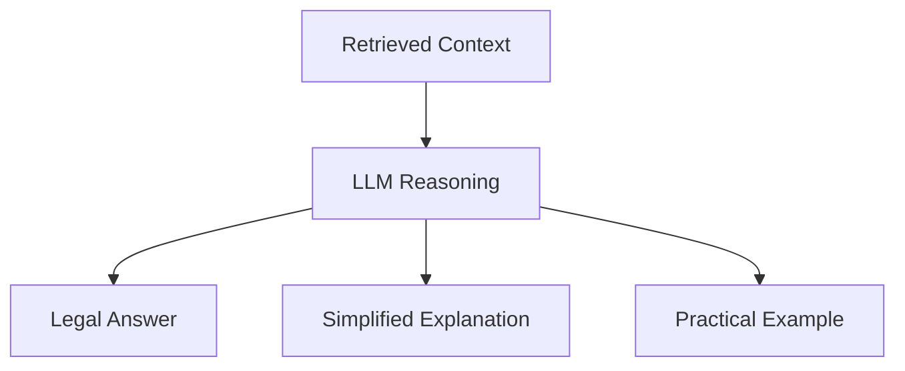
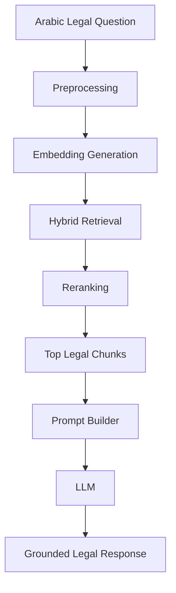
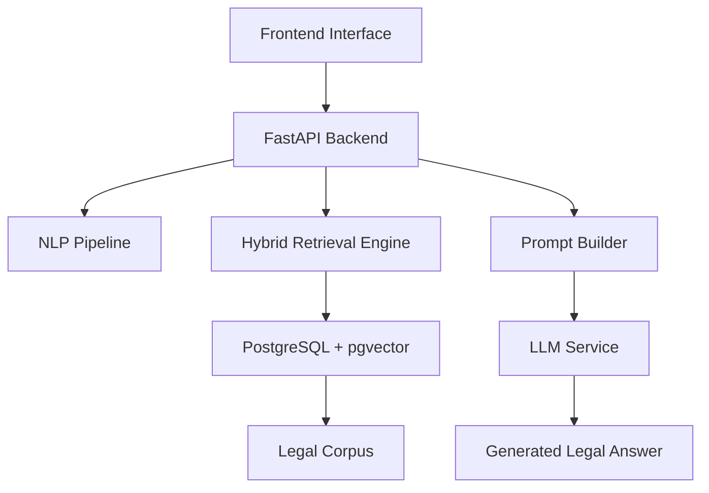

# Phase 4 — Implementation of the Retrieval-Augmented Generation (RAG) System

# 1. Introduction

After completing the stages of:

- data gathering
- data validation
- NLP processing
- embedding generation

the final phase focuses on implementing the complete Retrieval-Augmented Generation (RAG) system.

The RAG architecture combines:
- semantic retrieval
- legal document search
- Large Language Models (LLMs)

to generate contextual and grounded legal responses based on Moroccan law.

The purpose of this phase is to create an intelligent legal assistant capable of:
- understanding Arabic legal questions
- retrieving relevant legal documents
- generating accurate and explainable legal answers

---

# 2. Objectives of the RAG System

The main objectives are:

- retrieve relevant legal information
- reduce hallucinations
- generate grounded legal answers
- provide contextual explanations
- support Arabic legal reasoning
- improve answer reliability

---

# 3. Global RAG Architecture

```mermaid
flowchart TD

A[User Legal Question]
--> B[Query Preprocessing]

B --> C[Embedding Generation]
C --> D[Hybrid Retrieval Engine]

D --> E[Top-K Legal Chunks]
E --> F[Prompt Construction]

F --> G[LLM Generation]
G --> H[Final Legal Response]
````

---

# 4. User Query Processing

The pipeline begins when the user submits a legal question in Arabic.

## Example Questions

```text id="v9a71s"
ما هي عقوبة السرقة في القانون المغربي؟
```

```text id="9e2j7v"
كيف يتم رفع دعوى الطلاق؟
```

---

# 5. Query Preprocessing

The user query passes through the NLP pipeline.

## Processing Steps

* Arabic normalization
* tokenization
* stopword filtering
* semantic preparation
* embedding generation

---

# 6. Query Embedding Generation

The cleaned legal question is converted into a semantic vector representation.

## Embedding Workflow



---

# 7. Retrieval Engine

The retrieval system searches the legal knowledge base for relevant legal chunks.

The project uses Hybrid Retrieval:

* vector similarity search
* keyword-based BM25 search

---

# 8. Hybrid Retrieval Architecture



---

# 9. Semantic Retrieval

Semantic retrieval identifies legal content based on meaning rather than exact words.

This allows the system to retrieve:

* semantically related legal articles
* contextual legal explanations
* related legal concepts

---

# 10. BM25 Lexical Retrieval

BM25 improves retrieval precision for:

* legal article references
* exact legal terminology
* specific law names
* procedural terms

Example:

```text id="8mfw6q"
المادة 507
```

---

# 11. Reranking Phase

After retrieval, documents are reranked according to relevance.

The reranker improves:

* legal accuracy
* contextual matching
* answer grounding

---

# 12. Reranking Pipeline


---

# 13. Top-K Retrieval Strategy

The system retrieves the most relevant legal chunks.

Typical configuration:

| Parameter         | Value   |
| ----------------- | ------- |
| Initial Retrieval | Top 20  |
| Reranked Results  | Top 5   |
| Final Context     | Top 3–5 |

---

# 14. Prompt Construction

The retrieved legal chunks are inserted into a structured Arabic prompt.

The prompt provides:

* legal context
* retrieved evidence
* instructions for reasoning
* response formatting

---

# 15. Prompt Engineering Structure



---

# 16. Example Prompt Template

```text id="k3j82s"
أنت مساعد قانوني متخصص في القانون المغربي.

اعتمد فقط على المعلومات القانونية التالية للإجابة:

[السياق القانوني]

السؤال:
[سؤال المستخدم]

قم بتقديم:
- الجواب القانوني
- شرح مبسط
- مثال تطبيقي
```

---

# 17. Large Language Model Integration

The final prompt is sent to the LLM.

The model generates:

* legal explanations
* contextual answers
* simplified reasoning
* procedural guidance

---

# 18. Candidate LLMs

| Model   | Usage                       |
| ------- | --------------------------- |
| GPT-4   | High-quality reasoning      |
| Mistral | Lightweight inference       |
| Qwen    | Strong multilingual support |
| LLaMA   | Local deployment            |
| Phi     | Efficient small model       |

---

# 19. Legal Response Generation

The generated response should contain:

* legal answer
* simplified explanation
* legal context
* procedural reasoning
* references to retrieved laws

---

# 20. Final Response Architecture



---

# 21. Grounded Generation

The system must generate answers only from retrieved legal documents.

This reduces:

* hallucinations
* fabricated laws
* unsupported legal claims

---

# 22. Hallucination Prevention

## Protection Mechanisms

| Mechanism           | Purpose                      |
| ------------------- | ---------------------------- |
| Retrieval grounding | Evidence-based answers       |
| Limited context     | Controlled generation        |
| Prompt constraints  | Restrict unsupported outputs |
| Metadata references | Traceability                 |

---

# 23. Full RAG Pipeline



---

# 24. Legal Domain Classification

The system may classify legal queries automatically before retrieval.

## Categories

* قانون الأسرة
* القانون الجنائي
* قانون السير
* القانون المدني
* الإجراءات القضائية

---

# 25. Conversation Memory

The chatbot may support contextual memory for multi-step legal discussions.

Example:

* initial legal question
* follow-up clarification
* procedural continuation

---

# 26. PDF Knowledge Base Integration

The application allows users to upload new legal PDFs.

Workflow:


---

# 27. Multi-Knowledge-Base Support

Users can switch between:

* criminal law database
* family law database
* traffic law database
* uploaded custom legal corpora

---

# 28. Evaluation and Benchmarking

The project evaluates retrieval and generation quality.

## Evaluation Metrics

| Metric           | Purpose             |
| ---------------- | ------------------- |
| Precision@K      | Retrieval relevance |
| Recall@K         | Coverage            |
| MRR              | Ranking quality     |
| Faithfulness     | Grounding accuracy  |
| Response Quality | Legal coherence     |
| Latency          | System performance  |

---

# 29. System Technologies

## Backend

| Technology | Purpose          |
| ---------- | ---------------- |
| FastAPI    | API backend      |
| PostgreSQL | Legal storage    |
| pgvector   | Vector retrieval |
| Docker     | Deployment       |

---

## NLP and Retrieval

| Technology            | Purpose             |
| --------------------- | ------------------- |
| sentence-transformers | Embeddings          |
| rank-bm25             | Lexical retrieval   |
| transformers          | LLM integration     |
| rerankers             | Result optimization |

---

## Frontend

| Technology | Purpose             |
| ---------- | ------------------- |
| SvelteKit  | Web interface       |
| Tauri      | Desktop deployment  |
| Streamlit  | Prototype interface |

---

# 30. Full System Architecture



---

# 31. Expected Output of Phase 4

At the end of this phase, the system should provide:

* Arabic legal chatbot
* semantic legal retrieval
* grounded legal responses
* multilingual support
* legal question answering
* PDF knowledge base upload
* interactive legal dashboard

---

# 32. Expected System Capabilities

The final system should be capable of:

* understanding Arabic legal questions
* retrieving Moroccan legal articles
* generating contextual legal answers
* explaining laws in simplified Arabic
* supporting legal reasoning
* handling multiple legal domains

---

# 33. Conclusion

The implementation of the RAG system represents the final integration phase of the Moroccan Legal AI assistant.

This phase combines:

* NLP processing
* semantic retrieval
* vector databases
* reranking
* prompt engineering
* Large Language Models

to create a grounded and context-aware legal assistant specialized in Moroccan law.

The RAG architecture improves retrieval precision, reduces hallucinations, and enables reliable legal question answering using structured Arabic legal knowledge bases.
